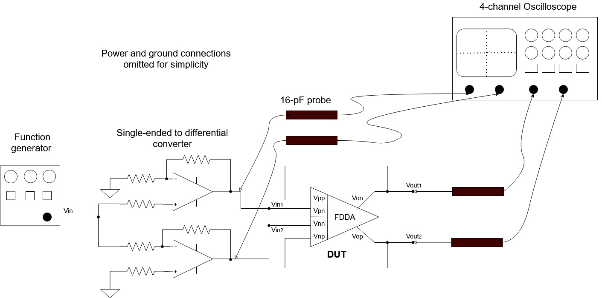

## Fully Differential Difference Amplifier - Test Plan

The Fully Differential Difference Amplifier (FDDA) is intended for use as a buffer in differential $G_m-C$ filter
circuits. The output load capacitance must not impair the frequency response of the filter, and the buffer has a
fundamental role on decoupling the load capacitance from the capacitances of the filter. For the tests, the following
setup is required:

1. A single output function generator with frequency, amplitude and offset adjustment options.
2. An operational amplifier based circuit capable of generating two symmetrical outputs from a single-ended input. The
   operational amplifiers used should be designed for low voltage, single supply operation.
3. The chip with the FDDA circuit, herein referred to as DUT (device under test).
4. A four-channel digital oscilloscope with low-capacitance ($\approx 16\text{ pF}$) passive input probes (achieved by
   setting the probes to $10\times$ attenuation).

The setup is illustrated by Figure 1:

_Figure 1 - Test setup schematic for the FDDA characterization_

Using this setup, the following tests will be performed:

- Frequency Response: By setting a fixed input amplitude and sweeping across several frequencies for differential
  sinusoidal inputs, the output signal amplitudes can be measured using the digital oscilloscope. A flat response is
  expected over the range of $0\text{ to }150\text{ kHz}$. The $-3\text{ dB}$ bandwidth in a closed-loop configuration
  will also be recorded.
- Input Range and Linearity: At a fixed frequency, the amplitude of the sinusoidal input signals will be varied from
  small-signal levels to higher amplitudes until visible distortion occurs. Waveforms at various amplitudes will be saved
  and post-processed to measure Total Harmonic Distortion (THD) as an indicator of linearity.
- Slew Rate and Transient Response: By applying a square-wave signal from the function generator, both positive and
  negative slew rates of the differential output can be evaluated. Settling time and overall transient behavior will also
  be characterized.
- Common-Mode Response: The setup can be reconfigured to apply the same signal from the function generator
  simultaneously to both positive and negative inputs, enabling characterization of the common-mode response and
  Common-Mode Rejection Ratio (CMRR).

Important Operating Note: For all tests, a DC offset of $V_{DD}/2 = 1.65\text{ V}$ must be applied to the signal
provided by the function generator, as the common-mode voltage of the FDDA is internally set to $V_{DD}/2$. Additional
characterizations such as response under varying load capacitances, supply voltages other than $3.3\text{ V}$, or Power
Supply Rejection Ratio (PSRR) via supply modulation may also be conducted.
